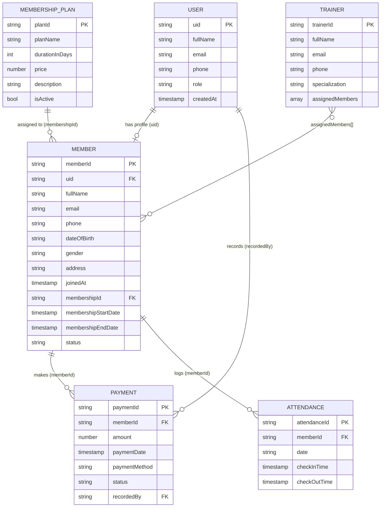

# Database Documentation: Forge Fitness Club Gym Management System

## 1. Problem statement
Small gyms track members, plans, payments and attendance in notebooks or spreadsheets. Expiry dates get missed, revenue is hard to total, and members cannot check their own status. This project replaces that with a Cloud Firestore database behind a role-based web app.

## 2. Objectives
- Store members, plans, payments, attendance and trainers in one consistent database.
- Give the owner (admin) full CRUD and reporting; give each member read-only access to their own records.
- Enforce access on the server with Firestore Security Rules, not by hiding buttons.
- Keep derived data (expiry date, status, totals) consistent with the records that produce it.

## 3. Requirements
**Functional:** authentication; admin CRUD for members, plans, trainers; plan assignment with automatic expiry; manual payment records; daily attendance with one entry per member per day; dashboards, charts and CSV export; member self-service view.
**Non-functional:** responsive UI; least-privilege security; server timestamps on important records; clear loading, empty and error states; no secrets in source (config in `.env`).

## 4. ER diagram

A User with `uid` also exists in Firebase Authentication; the `users` document stores the profile and role.

## 5. Schema, keys and relational mapping
| Collection (table) | Primary key (document ID) | Foreign-key equivalents | Notes |
|---|---|---|---|
| `users` (USER) | `uid` (= Auth UID) | none | `role`: `admin` or `member`. Real admin authority is the `admin` custom claim. |
| `members` (MEMBER) | `memberId` (= `uid` for self-registered; auto ID for walk-ins) | `uid` -> users, `membershipId` -> membershipPlans | Walk-in members have `uid: ""` and no login. |
| `membershipPlans` (MEMBERSHIP_PLAN) | `planId` | none | Publicly readable price list. |
| `payments` (PAYMENT) | `paymentId` | `memberId` -> members, `recordedBy` -> users | Manual records only. |
| `attendance` (ATTENDANCE) | `memberId_YYYY-MM-DD` | `memberId` -> members | Composite natural key prevents duplicates. |
| `trainers` (TRAINER) | `trainerId` | `assignedMembers[]` -> members | Array replaces a junction table. |

## 6. Relationships and cardinality
| Relationship | Cardinality | How it is modelled |
|---|---|---|
| User - Member | 1 : 0..1 | `members.uid` (and shared document ID) |
| MembershipPlan - Member | 1 : N | `members.membershipId` |
| Member - Payment | 1 : N | `payments.memberId` |
| Member - Attendance | 1 : N | `attendance.memberId` |
| User (admin) - Payment | 1 : N | `payments.recordedBy` |
| Trainer - Member | M : N | `trainers.assignedMembers` (array of member IDs) |

## 7. Integrity and validation
| Rule | Enforced by |
|---|---|
| Self-registration can only create `role: "member"` | Security rules on `users` create |
| Only admins write members (except a pending self-profile), plans, payments, attendance, trainers | Security rules (`request.auth.token.admin`) |
| Members read only their own member, payment and attendance documents | Rules + `where("memberId","==",uid)` queries |
| Plan: name present, `durationInDays` int > 0, `price` >= 0 | Client forms + `validPlan()` rule |
| Payment: amount > 0, method and status from fixed sets | Client forms + `validPayment()` rule |
| One check-in per member per day | Document ID `memberId_date` + transaction + `create`-only rule |
| Server-trusted timestamps | `serverTimestamp()` checked with `== request.time` in rules |
| Expiry = start + `durationInDays` | `assignPlan()` computes it; plan and payment written in one batch |
| Deleting a member cascades to payments and attendance and unlinks trainers | `deleteMember()` batch |
| Status (active, expiring, expired) never goes stale | Derived from `membershipEndDate` at read time |
| No plaintext passwords stored | Firebase Authentication holds credentials |

## 8. CRUD examples (SQL vs Firestore SDK)
```js
// CREATE   INSERT INTO members (...) VALUES (...)
const ref = doc(collection(db, "members"));
await setDoc(ref, { memberId: ref.id, fullName, email, phone, joinedAt: serverTimestamp(), status: "pending" });

// READ     SELECT * FROM members WHERE membershipId = :planId
await getDocs(query(collection(db, "members"), where("membershipId", "==", planId)));

// UPDATE   UPDATE members SET phone = :p WHERE memberId = :id
await updateDoc(doc(db, "members", id), { phone });

// DELETE   DELETE FROM members WHERE memberId = :id
await deleteDoc(doc(db, "members", id));
```

## 9. Example queries
| SQL | Firestore |
|---|---|
| `SELECT * FROM payments WHERE memberId=:m ORDER BY paymentDate DESC` | `query(collection(db,"payments"), where("memberId","==",m))` then sort by `paymentDate` (client sort avoids a composite index) |
| `SELECT SUM(amount) FROM payments WHERE status='paid'` | `getDocs(query(payments, where("status","==","paid")))` then sum in JS (or `getAggregateFromServer(sum("amount"))`) |
| `SELECT * FROM attendance WHERE date >= :d ORDER BY date DESC` | `query(attendance, where("date",">=",d), orderBy("date","desc"))` |
| `SELECT * FROM members WHERE membershipEndDate < NOW()` | `query(members, where("membershipEndDate","<",Timestamp.now()))` |
| `JOIN members ON payments.memberId = members.memberId` | Two reads, joined in the app by ID (`Object.fromEntries(members.map(m => [m.id, m.fullName]))`) |
| Check-in (unique per day) | `runTransaction`: read `attendance/{memberId_date}`; abort if it exists; else `set` |

## 10. Sample records
```json
// users/uA1
{ "uid": "uA1", "fullName": "Gym Owner", "email": "owner@example.com", "phone": "", "role": "admin", "createdAt": "2026-10-01T09:00Z" }
// membershipPlans/p30
{ "planId": "p30", "planName": "Monthly", "durationInDays": 30, "price": 1200, "description": "Month-to-month access.", "isActive": true }
// members/m17
{ "memberId": "m17", "uid": "", "fullName": "Aarav Shah", "email": "aarav@example.com", "phone": "9800000000", "joinedAt": "2026-09-20", "membershipId": "p30", "membershipStartDate": "2026-09-20", "membershipEndDate": "2026-10-20", "status": "active" }
// payments/pay9
{ "paymentId": "pay9", "memberId": "m17", "amount": 1200, "paymentDate": "2026-09-20", "paymentMethod": "upi", "status": "paid", "recordedBy": "uA1" }
// attendance/m17_2026-10-12
{ "attendanceId": "m17_2026-10-12", "memberId": "m17", "date": "2026-10-12", "checkInTime": "06:30", "checkOutTime": "07:40" }
// trainers/t3
{ "trainerId": "t3", "fullName": "Arjun Mehta", "email": "arjun@forge.example", "phone": "9800000001", "specialization": "Strength", "assignedMembers": ["m17"] }
```

## 11. Firestore vs a relational DBMS
| Topic | Relational (MySQL, PostgreSQL) | Cloud Firestore |
|---|---|---|
| Model | Tables, rows, fixed schema | Collections of JSON-like documents, flexible schema |
| Relationships | Foreign keys, JOINs | IDs and references; joins done in application code |
| Integrity | Constraints, triggers, ON DELETE CASCADE | Security Rules, transactions, batched writes, app logic |
| Query language | SQL | SDK queries (filters, orderBy, limit); no JOIN, limited OR and aggregates |
| Transactions | Full ACID across tables | ACID transactions and atomic batches (limit 500 writes) |
| Scaling | Mostly vertical | Automatic horizontal scaling, real-time listeners |
| Normalisation | Encouraged | Selective denormalisation is common (here, `assignedMembers[]` stands in for a junction table) |

Firestore is a NoSQL document database. It does not enforce foreign keys; this project keeps references valid through the service layer and rules.

## 12. Frontend database activity
The **DB activity** control, available on every page including login and registration, shows the Firebase Authentication and Firestore requests made during the current app session as SDK-style source text, along with request status and duration. Query text includes actual Firestore collection/document paths and filter values. Written document fields are shown with values redacted to avoid exposing personal data, and authentication credentials are always redacted. Batched writes and transactions appear as one atomic operation; real-time member subscriptions appear as live listeners. This is an in-app activity view, not a server-side audit log or a display of Firestore's internal SQL (Firestore does not execute SQL).

## 13. Limitations and future improvements
- No automatic foreign-key checks, so orphaned references are possible if data is edited outside the app.
- Dashboard totals load collections on the client. At larger scale, move them to aggregation queries or Cloud Functions that maintain summary documents.
- Member deletion removes Firestore data only; the Firebase Auth account needs Admin SDK or a Cloud Function to delete.
- Walk-in members have no login; linking them to an account later would need a Cloud Function.
- Payments are manual records. A real gateway (for example Razorpay) would need server-side webhooks.
- Possible additions: renewal reminders by email or SMS, class bookings, QR check-in, trainer self-service, Cloud Function that expires memberships nightly.
